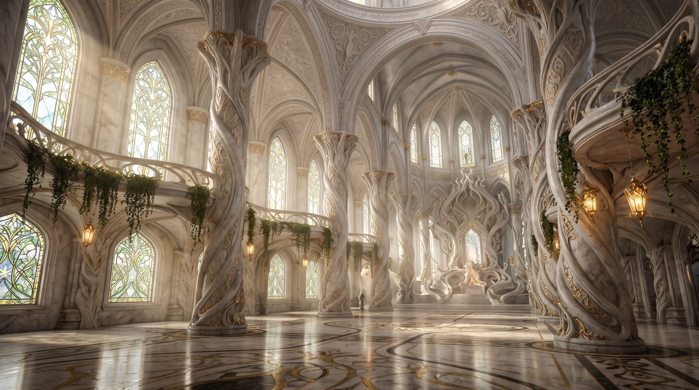
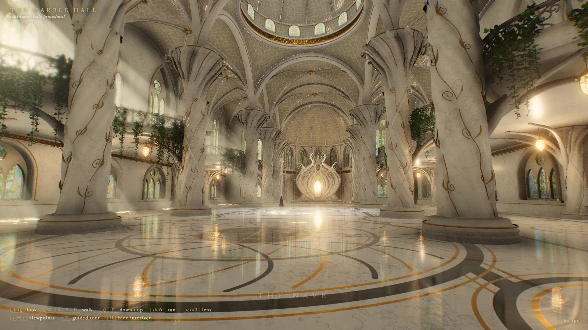

# The Marble Hall

A real-time, fully procedural 3D reconstruction of a marble cathedral hall, built in three.js from a single reference image. No external models or textures: all geometry and textures are generated in code at load.

## Reference



## Result



## Running it

```sh
npm install
npm start        # serves on http://localhost:8377
```

It needs a local server; opening `index.html` directly will not work.

**Controls:** drag to look, `WASD` to walk, `Q`/`E` down/up, `Shift` to run, scroll to change the lens, `1`–`7` for viewpoints, `T` for a guided tour, `H` to hide the interface.

## Process

1. **Studied the reference.** Cropped the image into regions (columns, throne, windows, floor) to work out the layout, proportions and where the sun comes from.
2. **Fixed a floor plan.** A nave 18 m wide with 13 m aisles, bays every 11 m, an 18 m crossing under the dome, and a semicircular apse. Every piece is placed off that grid.
3. **Generated the geometry in code** (`src/geo.js`, `src/hall.js`):
   - **Columns:** a parametric surface whose radius varies with angle and height to make twisted lobes, plus swept tubes for vines, gold threads and capital fronds.
   - **Vaults:** a height field taking the higher of two pointed-arch profiles per bay, with tube ribs along the edges and diagonals.
   - **Dome:** a spherical pendentive surface, drum and shell.
   - **Walls:** extruded shapes with arch-shaped holes, then tracery and glass set into the openings.
   - **Ivy:** about 45k instanced leaves.
   - Everything else is merged into one mesh per material to keep draw calls low.
4. **Generated the textures** (`src/textures.js`): stained glass, carved filigree and floor inlay are drawn on 2D canvases; marble veining is computed in the shader from a 3D noise texture, so it needs no UVs and has no seams.
5. **Lit it** (`src/main.js`, `src/materials.js`):
   - One shadow-casting sun, plus lantern, throne and dome lights.
   - The glass is rendered from the sun's viewpoint into a colour texture that tints the sunlight where it lands.
   - A cubemap captured from inside the hall, twice, provides bounce light.
   - The floor is re-rendered from a mirrored camera for reflections.
6. **Post-processed** (`src/post.js`): the HDR scene render goes through ambient occlusion, ray-marched light shafts against the sun's depth map, bloom, ACES tone mapping with a colour grade, and anti-aliasing.
7. **Iterated on screenshots.** Drove headless Chrome to capture seven viewpoints, compared against the reference, and tuned over about five rounds. The main fixes were noisy marble, fat columns, flat ambient light and blown-out glass.

## Cost and time

Built by Claude Fable 5.2 in Claude Code, in a single session from one prompt. Figures are read from the session transcript and cover the build only, from the request to the final verified screenshot.

| | |
|---|---|
| Wall-clock time | about 28 minutes |
| Output tokens | 143,621 |
| Input tokens (uncached) | 68 |
| Cache-write tokens | 207,304 |
| Cache-read tokens | 4,935,767 |
| Total tokens processed | about 5.29 million |
| Model requests | 32 |

Most of the total is cache reads: the growing conversation is re-read on every request, and those tokens are billed at a small fraction of the normal input rate.

### Equivalent API cost

At standard Claude Fable 5.2 API rates (standard speed, 1-hour cache writes, as recorded in the transcript):

| Token type | Tokens | Rate per million | Cost |
|---|---|---|---|
| Output | 143,621 | $40.00 | $5.74 |
| Cache write (1-hour) | 207,304 | $16.00 | $3.32 |
| Cache read | 4,935,767 | $0.20 | $0.99 |
| Input (uncached) | 68 | $8.00 | $0.00 |
| **Total** | | | **about $10.05** |

The session ran on a $200/month subscription, so nothing was billed per token; this is what the same usage would cost on pay-as-you-go API pricing, roughly 5% of one month's subscription fee. Rates are from the pricing reference bundled with Claude Code (cached 2026-11-03); the cache-write rate is that reference's 2x-input multiplier for 1-hour writes rather than a separately listed price.

## Scene statistics and hardware requirements

Measured in the running scene with headless Chrome on an Apple M5 Max (40-core GPU, 128 GB RAM). That is a top-end machine, so the frame times below are a best case, not what a typical laptop will see.

### Geometry

| Mesh (one per material) | Triangles |
|---|---|
| Marble (columns, walls, ribs, gallery, throne) | 1,215,460 |
| Gold (threads, trims, lantern frames) | 547,104 |
| Ivy leaves (45,171 instances of an 8-triangle leaf) | 361,368 |
| Vault and dome surfaces | 56,920 |
| Window tracery | 42,388 |
| Ivy stems | 23,178 |
| Everything else (glass, relief bands, lanterns, door, figure, floor) | 5,755 |
| **Total** | **2,252,173** |

- 1.17 million unique vertices, about 60 MB of vertex and index data.
- 18 mesh objects in the scene, plus 2,600 dust particles.
- 22 lights: one shadow-casting sun, one spotlight, one hemisphere fill and 19 point lights.

### Per-frame workload

| | |
|---|---|
| Draw calls per frame, all passes | 61 |
| Triangles submitted per frame | 4.5 million (the scene is drawn twice: main view and floor reflection) |
| Shader programs | 44 |
| Sun shadow map | 6144 x 6144, rendered once at load and reused |
| Frame time at 1920 x 1080 | 7.0 ms (about 140 fps uncapped) |
| Frame time at 2560 x 1440 | 9.5 ms (about 105 fps uncapped) |
| Load time (build geometry and textures) | 1 to 4 seconds |

The cost is mostly per pixel, not per triangle. Each visible pixel runs the marble shader (about 20 3D-texture lookups), loops over all 22 lights, and is 4x multisampled. On top of that come ambient occlusion (12 samples), light shafts (44 ray-march steps at half resolution), bloom and anti-aliasing. Frame time therefore scales with resolution.

### Memory

| | |
|---|---|
| JavaScript heap (measured) | about 215 MB |
| GPU memory at 1080p (estimated) | about 0.9 GB |
| GPU memory at 1440p (estimated) | about 1.2 GB |

The GPU figures are calculated from the buffer and texture sizes, not read from the driver. The largest items are the shadow map (150 to 300 MB), the two 4096 x 4096 floor textures (about 170 MB), the stained-glass light texture (about 130 MB) and the multisampled HDR render targets (270 MB at 1080p, 480 MB at 1440p).

### What you need to run it

These are estimates extrapolated from the measurements above. Only the M5 Max was actually tested.

| | Minimum | Recommended |
|---|---|---|
| GPU | Recent integrated graphics (Apple M1, Intel Iris Xe, Radeon 780M); expect roughly 20 to 30 fps at 1080p | Apple M-series Pro or Max, or a discrete card of GeForce RTX 3060 class or better, for 60 fps at 1440p |
| GPU memory | 2 GB | 4 GB or more |
| System RAM | 8 GB | 16 GB |
| Browser | A desktop browser with WebGL 2 and float render targets (current Chrome, Edge, Firefox, Safari) | Chrome or Edge |

Phones and tablets are unlikely to run it well.

### Reducing the load

- Add `?q=0.5` (or any value below 1) to the URL to lower the render resolution; below 1 it also drops the shadow map to 4096.
- Press `O`, `V` or `B` to switch off ambient occlusion, light shafts or bloom.
- The render resolution is already capped at 1.5x device pixels on high-density screens.

## Known differences from the reference

- The throne reads as a lotus of marble ribbons rather than dense interwoven carving.
- Walls and columns carry less relief carving.
- The hall is symmetric, so the right side has a matching gallery instead of the round balcony pod around the foreground column.
- The colour is slightly cooler and greener than the reference's cream-gold.

Tested only in headless Chrome on macOS; not tested in Safari, Firefox or on mobile.
